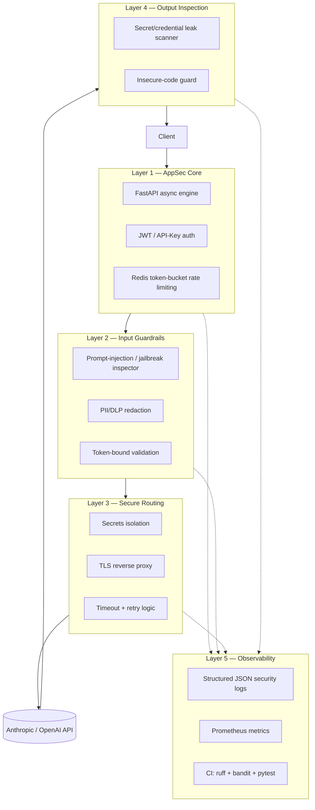

# AI Security Gateway — Σημειώσεις Έργου

> [!info] Σκοπός αυτού του σημειώματος
> Πλήρης τεχνική καταγραφή του project όπως στήθηκε στη Συνεδρία 1 (2026-09-06): αρχιτεκτονική, αποφάσεις σχεδιασμού, δομή κώδικα, οδηγίες εκτέλεσης, προβλήματα που αντιμετωπίστηκαν, και επόμενα βήματα. Γράφτηκε για να μπορεί κάποιος (συμπεριλαμβανομένου εμένα σε 3 μήνες) να καταλάβει το project χωρίς να χρειαστεί να ξαναδιαβάσει όλον τον κώδικα.

## 1. Επισκόπηση

Το **AI Security Gateway** είναι ένας production-grade, ασύγχρονος reverse proxy σε Python/FastAPI που τοποθετείται ανάμεσα σε clients και σε εξωτερικά AI APIs (Anthropic, OpenAI). Ο σκοπός του δεν είναι απλώς να προωθεί αιτήματα, αλλά να λειτουργεί ως **επίπεδο ασφαλείας (security control plane)** πάνω από LLM κλήσεις: επαλήθευση ταυτότητας, προστασία από κατάχρηση, φιλτράρισμα επικίνδυνου περιεχομένου εισόδου/εξόδου, και πλήρης παρατηρησιμότητα (observability) για SOC/SIEM ενοποίηση.

Η σχεδίαση ακολουθεί ρητά το **OWASP Top 10 for LLM Applications** (ιδίως LLM01 — Prompt Injection, και LLM06 — Sensitive Information Disclosure), και ενσωματώνει πρακτικές DevSecOps (SAST στο CI, structured security logging).

## 2. Αρχιτεκτονική — 5 Επίπεδα



Κάθε αίτημα περνάει διαδοχικά από τα Layers 1→4· το Layer 5 δεν είναι σειριακό βήμα αλλά "παρατηρεί" όλα τα άλλα (logging/metrics hooks μέσα σε κάθε layer).

## 3. Τεχνική Στοίβα

| Στοιχείο | Επιλογή | Αιτιολογία |
|---|---|---|
| Web framework | FastAPI + Uvicorn | Native async, αυτόματο OpenAPI/Swagger (`/docs`), εξαιρετική DX |
| HTTP client προς upstream | httpx (async) | Ίδιο μοντέλο concurrency με FastAPI, connection pooling |
| Auth | JWT (python-jose) + στατικά API keys | Δύο μηχανισμοί: JWT για session-based clients, API key για service-to-service |
| Rate limiting | Redis + Lua script (token bucket) | Ατομικότητα (atomicity) σε multi-replica deployment χωρίς race conditions |
| Config | pydantic-settings | Type-safe validation, φόρτωση από `.env` |
| Λογισμικό logging | structlog | JSON output έτοιμο για SIEM (Sentinel/Splunk) χωρίς custom parser |
| Metrics | prometheus-client | Βιομηχανικό στάνταρ, scrape-based, όχι push |
| Testing | pytest + fakeredis[lua] + respx | Καμία εξάρτηση από πραγματικό Redis/upstream API στα tests |
| CI | GitHub Actions | ruff (lint) + bandit (SAST) + pytest (με πραγματικό Redis service container) |

> [!warning] Σκόπιμη απόφαση: όχι tiktoken
> Αρχικά σχεδιάστηκε token counting με `tiktoken`, αλλά αφαιρέθηκε γιατί κατεβάζει τα BPE αρχεία του από το δίκτυο την πρώτη φορά που τρέχει — θα έκανε το gateway να εξαρτάται από δίκτυο που μπορεί να μην υπάρχει (π.χ. σε πλήρως απομονωμένο production δίκτυο). Αντικαταστάθηκε με έναν ντετερμινιστικό, offline προσεγγιστικό μετρητή token (`app/guardrails/token_bound.py`) με συντελεστή ασφαλείας 1.3x (τείνει να υπερεκτιμά, όχι να υποεκτιμά).

## 4. Δομή Φακέλων

```
ai-security-gateway/
├── app/
│   ├── main.py                  # FastAPI app factory, wiring όλων των layers
│   ├── core/
│   │   ├── config.py            # pydantic-settings, όλα τα env vars
│   │   ├── security.py          # JWT + API-key auth (Principal, get_current_principal)
│   │   ├── secrets.py           # Απομόνωση upstream API keys (seam για Vault στο μέλλον)
│   │   ├── redis_client.py      # Singleton async Redis client
│   │   ├── upstream.py          # forward_with_retry() — timeout/backoff logic
│   │   └── message_payload.py   # Εφαρμογή guardrails πάνω σε Anthropic/OpenAI message shapes
│   ├── guardrails/
│   │   ├── prompt_injection.py  # Regex + heuristics + unicode-normalization
│   │   ├── pii_dlp.py           # Email/phone/ΑΦΜ(checksum)/κάρτα(Luhn) redaction
│   │   ├── token_bound.py       # Offline approximate token counter
│   │   ├── output_inspection.py # Secret-leak & insecure-code scanning στην απάντηση
│   │   └── exceptions.py        # GuardrailViolation και υποκλάσεις
│   ├── middleware/
│   │   └── rate_limit.py        # RedisTokenBucketLimiter + ASGI middleware
│   ├── observability/
│   │   ├── logging.py           # structlog config, log_security_event()
│   │   └── metrics.py           # Prometheus counters/histograms, MetricsMiddleware
│   └── routers/
│       └── proxy.py             # /v1/anthropic/messages, /v1/openai/chat/completions
├── tests/                       # 10 αρχεία, ~40 tests, πλήρες coverage ανά layer
├── .github/workflows/security.yml
├── docker-compose.yml           # gateway + redis
├── Dockerfile
├── requirements.txt / requirements-dev.txt
├── pyproject.toml               # ruff, bandit, pytest config
└── .env.example                 # Template — ΠΟΤΕ μην committάρεις το πραγματικό .env
```

## 5. Λεπτομέρειες ανά Layer

### Layer 1 — AppSec Core
Δύο μηχανισμοί αυθεντικοποίησης γίνονται δεκτοί ταυτόχρονα σε κάθε προστατευμένο endpoint: `Authorization: Bearer <JWT>` ή `X-API-Key: <id>:<secret>`. Το rate limiting υλοποιείται με **token bucket algorithm σε Lua script** εκτελούμενο atomικά μέσα στο Redis (όχι read-then-write στο Python, που θα είχε race condition σε πολλαπλά replicas του gateway). Κάθε ταυτότητα (API key id ή JWT subject, συνδυασμένη με IP) έχει το δικό της bucket.

### Layer 2 — Input Guardrails
Ο prompt-injection inspector δεν χρησιμοποιεί LLM call (θα πρόσθετε latency + κόστος) — είναι καθαρά regex/heuristic-based, με κανονικοποίηση unicode ώστε να μην ξεγελιέται από zero-width χαρακτήρες ή ασυνήθιστη απόσταση. Το PII/DLP module εντοπίζει και αντικαθιστά με placeholders (`[EMAIL_REDACTED_1]` κ.λπ.) emails, τηλέφωνα (Ελληνικά + διεθνή), ΑΦΜ (με πραγματικό αλγόριθμο checksum, όχι απλά "9ψήφιος αριθμός"), και πιστωτικές κάρτες (με Luhn validation, ώστε τυχαίοι 16ψήφιοι αριθμοί να μην redactάρονται λανθασμένα).

### Layer 3 — Secure Routing
Τα πραγματικά API keys της Anthropic/OpenAI **δεν φεύγουν ποτέ** από το `app/core/secrets.py` — προστίθενται στο outbound request μόνο εκεί. Retry logic μόνο σε transient σφάλματα (connection errors, timeouts, 502/503/504) — ποτέ σε 4xx, για να μην σπαταλιέται quota σε ήδη κακά requests.

### Layer 4 — Output Inspection
Σκανάρει αναδρομικά **όλα** τα string values μέσα στο JSON response (ανεξαρτήτως αν είναι Anthropic ή OpenAI schema) για: AWS keys, Anthropic/OpenAI/GitHub/Slack tokens, SSH private keys, hardcoded passwords, και επικίνδυνα code patterns (`eval()`, `os.system()`, `subprocess(shell=True)`, κ.λπ.). Blocking συμπεριφορά και για τα δύο (configurable μέσω `BLOCK_INSECURE_CODE_OUTPUT`).

### Layer 5 — Observability
`structlog` configured να παράγει JSON lines έτοιμα για SIEM forwarder, χωρίς custom parsing. Prometheus metrics στο `/metrics`: request volume, latency histogram, blocked-threats counter (ανά τύπο απειλής), rate-limit-triggered counter.

## 6. Πώς τρέχει

**Με Docker (recommended για production-like δοκιμή):**
```powershell
copy .env.example .env   # και συμπλήρωσε πραγματικά κλειδιά
docker compose up --build
```

**Χωρίς Docker (development, με fake in-process Redis):**
```powershell
python -m venv .venv
.venv\Scripts\Activate.ps1
pip install -r requirements-dev.txt
python -m uvicorn app.main:app --reload --port 8000
```

> [!info] Redis σε local dev: in-process fake client, όχι ξεχωριστός server
> Χωρίς Docker δεν υπάρχει πραγματικό Redis διαθέσιμο, και ο χρήστης προτίμησε να μην κατεβάσει/εγκαταστήσει τίποτα ξεχωριστό (π.χ. Memurai). Λύση: στο `.env`, `USE_FAKE_REDIS=true` — τότε το `app/core/redis_client.py` χρησιμοποιεί το **in-process** `fakeredis.aioredis.FakeRedis` αντί για πραγματική σύνδεση Redis. Αυτό είναι το ΙΔΙΟ mechanism που χρησιμοποιεί ήδη το test suite (`pytest`), οπότε είναι αποδεδειγμένα αξιόπιστο. Δεν χρειάζεται τρίτο terminal ή ξεχωριστή διεργασία — μόνο `.venv` + `uvicorn`. Για να συνδεθείς σε πραγματικό Redis αργότερα: βάλε `USE_FAKE_REDIS=false` (ή αφαίρεσέ το) και σωστό `REDIS_URL` στο `.env`, μετά restart του uvicorn (το `--reload` ΔΕΝ παρακολουθεί το `.env`).
>
> Ιστορικό: δοκιμάσαμε πρώτα `fakeredis.TcpFakeServer` σε ξεχωριστό terminal (`scripts/run_fake_redis.py`) ως "fake Redis πάνω από δίκτυο", αλλά ο πολύ απλοϊκός RESP parser του έσκαγε σε μεγαλύτερες εντολές (το Lua `EVAL` του rate limiter) — βλ. bug #6 παρακάτω. Το script παραμένει στο repo για αναφορά αλλά ΔΕΝ χρειάζεται πια.

Interactive exploration: `http://127.0.0.1:8000/docs` (Swagger UI). Health check: `/health`. Metrics: `/metrics`.

## 7. Testing

```powershell
pytest
```
53 tests, οργανωμένα ανά layer (`test_auth.py`, `test_rate_limit.py`, `test_prompt_injection.py`, `test_pii_dlp.py`, `test_token_bound.py`, `test_guardrails_pipeline.py`, `test_proxy.py`, `test_output_inspection.py`, `test_observability.py`). Χρησιμοποιεί `fakeredis` (με το `[lua]` extra, ώστε να τρέχει το πραγματικό Lua script) και `respx` για mock upstream responses — μηδενική εξάρτηση από πραγματικό Redis ή πραγματικά API keys.

> [!success] Επιβεβαιωμένο (Συνεδρία 1)
> `53 passed, 0 failed, 4 warnings in 19.74s` — τρέχει καθαρά στο `.venv` του χρήστη. Τα 4 warnings είναι deprecation notices τρίτων βιβλιοθηκών (`pytest-asyncio` fixture loop scope, `anyio.abc.BlockingPortal` alias, `datetime.utcnow()` στο `python-jose`) — αβλαβή, όχι bugs στον gateway.

## 8. Ημερολόγιο Προβλημάτων & Λύσεων (Συνεδρία 1)

> [!bug] #1 — PyPI μπλοκαρισμένο στο cloud sandbox
> Το `pip install` απέτυχε με `403 host_not_allowed` τόσο στο cloud container του Claude όσο και στο τοπικό VM του Cowork. **Λύση:** συνδέσαμε τοπικό φάκελο (`PycharmProjects`) και δουλέψαμε/τρέξαμε τα πάντα από πραγματικό terminal στον υπολογιστή — εκεί το PyPI δουλεύει κανονικά.

> [!bug] #2 — `python` δεν αναγνωριζόταν (Windows Store alias)
> Στο Windows, το `python` στο PATH ήταν stub που παραπέμπει στο Microsoft Store, όχι πραγματική εγκατάσταση. **Λύση:** χρήση του `py` launcher / σωστή εγκατάσταση Python, μετά ενεργοποίηση `.venv` όπου το `python` δουλεύει κανονικά.

> [!bug] #3 — Λάθος working directory
> Το πρώτο terminal ήταν ανοιχτό σε `C:\Windows\System32`, όχι στον φάκελο του project. **Λύση:** πάντα `cd` στο `C:\Users\techn\PycharmProjects\ai-security-gateway` πριν από οποιαδήποτε εντολή.

> [!bug] #4 — `REDIS_URL=redis://redis:6379/0` στο `.env` (docker-compose hostname) σε non-Docker εκτέλεση
> Χωρίς Docker, το hostname `redis` δεν γίνεται resolve (`getaddrinfo failed`, error 11001) — αυτό το hostname δουλεύει ΜΟΝΟ μέσα στο εσωτερικό δίκτυο του `docker-compose`. **Λύση:** `REDIS_URL=redis://localhost:6379/0` στο `.env`. Σημείωση: το `uvicorn --reload` παρακολουθεί μόνο `.py` αρχεία — αλλαγή στο `.env` απαιτεί χειροκίνητο restart (`Ctrl+C` + ξανά η εντολή).

> [!bug] #5 — `ResponseError: No matching script. Please use EVAL.` (EVALSHA/NOSCRIPT ασυμβατότητα με fakeredis)
> Ο rate limiter χρησιμοποιούσε `redis.register_script()` → `EVALSHA`, με αυτόματο fallback σε `EVAL` όταν ο server επιστρέφει `NOSCRIPT`. Το `fakeredis.TcpFakeServer` δεν επέστρεφε το error σε μορφή που αναγνωρίζει το `redis-py` ως `NoScriptError`, οπότε το fallback ποτέ δεν ενεργοποιούνταν. **Λύση:** αντικαταστάθηκε με απευθείας `redis.eval(...)` σε κάθε κλήση (χωρίς SHA caching) στο `app/middleware/rate_limit.py`.

> [!bug] #6 — `ConnectionError: Connection closed by server.` (ο `TcpFakeServer` κατέρρεε σε μεγάλες εντολές)
> Μετά το fix του #5, το πρόβλημα παρέμενε: το traceback στο terminal του `run_fake_redis.py` έδειξε ότι ο RESP parser του `TcpFakeServer` (`_tcp_server.py`) πετούσε `ValueError` σε μεγάλα multi-bulk commands (το `EVAL` με το ~30-γραμμών Lua script), και μετά η ίδια η error-handling διαδρομή του crashάρει με δευτερεύον `IndexError` προσπαθώντας να γράψει το error πίσω στον client — αυτό έκλεινε την TCP σύνδεση απότομα. Πρόκειται για γνωστό περιορισμό του πολύ απλοϊκού hand-rolled TCP/RESP layer του `fakeredis`, όχι bug στο δικό μας Lua script. **Λύση:** εγκαταλείψαμε εντελώς το TCP layer — το `app/core/redis_client.py` τώρα χρησιμοποιεί το in-process `fakeredis.aioredis.FakeRedis` (μέσω `USE_FAKE_REDIS=true` στο `.env`) όταν δεν υπάρχει πραγματικό Redis, το οποίο παρακάμπτει εντελώς το ασταθές network/RESP layer.

> [!bug] #7 — `/v1/anthropic/messages` και `/v1/openai/chat/completions` δεν έδειχναν πεδίο body στο Swagger ("No parameters")
> Τα δύο proxy endpoints διάβαζαν το JSON body χειροκίνητα (`await request.json()`) αντί να το δηλώνουν ως FastAPI parameter, οπότε δεν υπήρχε κανένα declared request body στο OpenAPI schema — το Swagger UI δεν έδειχνε κανένα πεδίο για δοκιμή. **Λύση:** `body: dict = Body(..., openapi_examples={...})` στο `app/routers/proxy.py`, με έτοιμο παράδειγμα request για κάθε endpoint. Λειτουργικά ισοδύναμο (ίδιο dict περνάει στο `sanitize_user_messages`), επιβεβαιωμένο με ξανατρέξιμο του test suite (53/53 passed, καμία παλινδρόμηση).

## 8α. Πλήρης επικύρωση end-to-end (2026-09-07)

> [!success] Το gateway επιβεβαιώθηκε πλήρως λειτουργικό, τοπικά, σε πραγματικές συνθήκες
> - `pytest` → **53 passed, 0 failed** (δύο ξεχωριστές φορές, πριν και μετά το fix #7 — καμία παλινδρόμηση)
> - `/health` → `200 OK`
> - `/v1/whoami` (με `X-API-Key: demo:demo-secret-change-me`) → `200 OK`, σωστό `subject`/`auth_method`
> - `/v1/anthropic/messages` με πραγματικό request body → το gateway πέρασε το request από **auth → rate limit (fake Redis) → input guardrails → πραγματική εξωτερική HTTPS κλήση προς `api.anthropic.com`** → πήρε πίσω `401` (αναμενόμενο, το `ANTHROPIC_API_KEY` στο `.env` είναι placeholder, όχι πραγματικό κλειδί) → το error καταγράφηκε σε structured JSON log (Layer 5) και προωθήθηκε σωστά στον client
>
> Δηλαδή και τα 5 layers επιβεβαιώθηκαν να συνεργάζονται σωστά μαζί, end-to-end. Για να δοκιμαστεί πραγματική κλήση με απάντηση από το μοντέλο, χρειάζεται πραγματικό `ANTHROPIC_API_KEY`/`OPENAI_API_KEY` από το console.anthropic.com / platform.openai.com (ξεχωριστό, pay-as-you-go — **δεν** καλύπτεται από συνδρομή Claude Pro).

## 9. Επόμενα Βήματα (Roadmap)

- [ ] Streaming responses (SSE) — προς το παρόν το proxy είναι μόνο non-streaming JSON in/out
- [ ] Demo client script (Python) που καλεί το gateway end-to-end
- [ ] Dependency vulnerability scanning (π.χ. `pip-audit`) στο CI, πέρα από το Bandit SAST
- [ ] Πραγματικό secrets backend (HashiCorp Vault / AWS Secrets Manager) αντί για `.env` — το seam υπάρχει ήδη σε `app/core/secrets.py`
- [ ] Multi-tenant rate limiting policies (διαφορετικά όρια ανά πελάτη/tier)
- [ ] Load testing (π.χ. locust) για επιβεβαίωση latency budget κάτω από φόρτο
- [ ] Βάλε πραγματικό `ANTHROPIC_API_KEY` (console.anthropic.com) στο `.env` για να δεις πραγματική απάντηση μοντέλου μέσα από το gateway
- [x] Παραγωγή OpenAPI security scheme ώστε το `/docs` "Authorize" κουμπί να δουλεύει out-of-the-box (fastapi.security.HTTPBearer + APIKeyHeader στο app/core/security.py)

## 10. Αναφορές

- Ακριβής τοποθεσία στον υπολογιστή: `C:\Users\techn\PycharmProjects\ai-security-gateway`
- CI pipeline: `.github/workflows/security.yml` (τρέχει σε κάθε push/PR σε `main`)
- OWASP Top 10 for LLM Applications: LLM01 (Prompt Injection) → Layer 2, LLM06 (Sensitive Information Disclosure) → Layer 4
